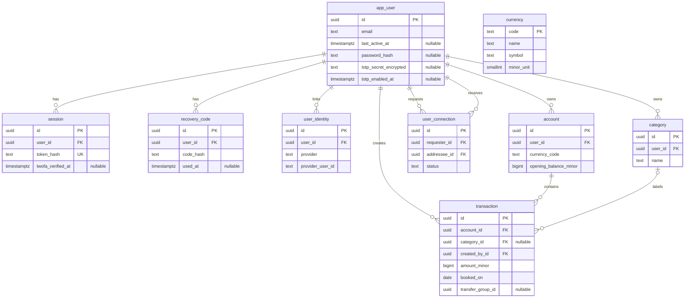

# expenses3000

expenses3000 is a personal expense tracker for managing accounts, transactions and financial insights.

Forked from an educational project.

## Description

| Topic | Description |
|---|---|
| Goal | Help users understand their finances through an independent personal ledger. |
| Core features | Accounts, categorized income and expenses, transfers, balances and per-currency analytics. |
| Account management | Email/password and optional Google sign-in, two-factor authentication, profiles, avatars and friends. |
| Data tools | Transaction search, JSON import, CSV export and interactive charts. |
| Interface | Responsive UI, light/dark themes, English, German, Persian (RTL) and Ukrainian, with accessibility checks. |

## Table of Contents

- [Description](#description)
- [Technical Stack](#technical-stack)
- [Instructions](#instructions)
  - [Prerequisites](#prerequisites)
  - [Docker setup](#docker-setup)
  - [Environment Setup](#environment-setup)
  - [Running Without Docker](#running-without-docker)
  - [Testing and CI](#testing-and-ci)
- [Database Schema](#database-schema)
- [Features List](#features-list)
- [Resources](#resources)

## Technical Stack

Major technologies and their purpose are listed below; exact dependency versions are committed in each application's lockfile.

| Area | Technologies | Rationale |
|---|---|---|
| Runtime and language | Node.js 22, TypeScript 5 | Shared language and static checking across both applications. |
| Frontend | Next.js 16.3.0, React 19.2.8 | Server-rendered pages, App Router and server actions for authenticated data flows. |
| UI and localization | Tailwind CSS 4, Lucide, next-intl 4 | Reusable themed components, responsive layouts, translations and Persian RTL. |
| Backend | Express 5.2.x | Explicit HTTP routing and middleware for validation, authentication and ownership. |
| Database | PostgreSQL 17, Drizzle ORM 0.45.2 | A ledger needs relational integrity: foreign keys tie transactions to accounts and users, CHECK constraints enforce amount signs, transfers write both legs atomically, and balances and analytics are computed with SQL aggregation. Drizzle adds type-safe queries and versioned migrations. |
| Authentication and validation | bcryptjs, session cookies, Google OAuth 2.0, authenticator-app TOTP (2FA), Zod and backend validators | Password hashing, Google sign-in, an additional verification step for password and Google logins, and validation at both input boundaries. |
| Visualization | Recharts 3 | Interactive financial charts with table alternatives. |
| Development and verification | Docker Compose v2, Make, GitHub Actions, Vitest, Bruno, Playwright/axe, ESLint and Prettier | Repeatable services and automated code, API and browser checks. |
| HTTPS | Nginx, mkcert | One trusted HTTPS entry point with internal-only application ports. |
| Monitoring | prom-client, Prometheus, Grafana, Alertmanager and Telegram | Collect metrics, visualize service health and send operational alerts to Telegram. |

## Instructions

Run commands from the repository root unless stated otherwise; frontend and backend are independent npm projects.

### Prerequisites

- Git
- Docker Engine or Docker Desktop, installed and running
- mkcert for local HTTPS certificates; `make up` downloads it when missing, see [certificate setup](docs/development.md#local-https)
- Docker Compose v2
- GNU Make 3.81 or newer
- Node.js 22 and npm for host development or local checks; provided by Docker otherwise
- PostgreSQL 17 for host development; provided by Docker Compose otherwise

Keep ports 3000 (frontend), 8443 (backend API), 3002 (Grafana) and 5432 (database) available.

### Docker setup

```bash
make up          # Full stack including backups, monitoring.
make dev         # Database, backend, frontend, Nginx and backups
```

When switching from the full stack to development mode, run `make down` first.

1. Clone the repository and enter its directory:

   ```bash
   git clone https://github.com/vkhvostov/expenses3000.git
   cd expenses3000
   ```

2. Replace the database, monitoring and Grafana placeholders in the root `.env`, creating it first if needed:

   ```bash
   cp .env.example .env
   ```

3. Start the services; this creates a local certificate with mkcert if missing (downloads mkcert if needed; trusting it may ask for your password, and without sudo the browser shows a warning, see [certificate setup](docs/development.md#local-https)), builds missing images and starts the application, HTTPS proxy, backups and monitoring. Compose creates the restricted monitoring database user automatically:

   ```bash
   make up
   ```

4. Check the containers and wait for the application services to become healthy:

   ```bash
   docker compose ps
   ```

5. Verify database readiness and operational status:

   ```bash
   curl -fsS --cacert nginx/certs/ca/rootCA.pem https://localhost:8443/health
   curl -fsS --cacert nginx/certs/ca/rootCA.pem https://localhost:8443/status
   ```

6. Open https://localhost:3000 (restart your browser after certificate setup); Grafana is at https://localhost:3002 (login required).

If a service does not become healthy, run `make logs` to inspect startup errors.
The root `.env` is required for monitoring; Google sign-in, 2FA and Telegram delivery use the optional settings below.

### Environment Setup

Environment variables tell the backend how to connect to PostgreSQL and tell the frontend where to send API requests.

#### Docker development

Set these values in the root `.env` before `make up`:

```env
POSTGRES_USER=<database-user>
POSTGRES_PASSWORD=<url-safe-database-password>
POSTGRES_EXPORTER_PASSWORD=<monitoring-database-password>
GRAFANA_ADMIN_USER=<grafana-admin-username>
GRAFANA_ADMIN_PASSWORD=<grafana-admin-password>
```

See the [monitoring setup](docs/monitoring.md#setup) for password generation, database initialization and Telegram secrets.

#### Host development

1. Create `backend/.env` with the credentials from the root `.env`:

   ```env
   DATABASE_URL=postgres://<database-user>:<database-password>@localhost:5432/expense_tracker
   ```

   `DATABASE_URL` connects the backend to PostgreSQL; the frontend origin defaults to `http://localhost:3000`.

2. Copy `frontend/.env.example` to `frontend/.env.local`:

   ```bash
   cp frontend/.env.example frontend/.env.local
   ```

   The example sets `NEXT_PUBLIC_API_URL` and `API_URL` to `http://localhost:3001`.
   `NEXT_PUBLIC_API_URL` is used by the browser; `API_URL` is used by Next.js on the server, so Docker uses the internal HTTPS proxy at `https://nginx:8443` with its trusted CA.

#### Google Sign-in and Two-Factor Authentication

See the development guide for [Google sign-in setup](docs/development.md#google-sign-in-setup), [two-factor authentication](docs/development.md#two-factor-authentication) and [environment and HTTPS notes](docs/development.md#environment-and-https-notes).

### Application URLs

| Service | URL | Verification |
|---|---|---|
| Frontend | https://localhost:3000 | Open in the browser. |
| Backend readiness | https://localhost:8443/health | `curl -fsS --cacert nginx/certs/ca/rootCA.pem https://localhost:8443/health` |
| Backend operational status | https://localhost:8443/status | `curl -fsS --cacert nginx/certs/ca/rootCA.pem https://localhost:8443/status` |
| Grafana | https://localhost:3002 | Sign in with the admin credentials from `.env`. |

### Running Without Docker

See the [host development setup](docs/development.md#running-without-docker).

### Testing and CI

GitHub Actions pipelines automate backend type checking, linting, formatting, unit and API tests, plus frontend linting, self-checks, builds, and browser accessibility and status-page checks.

| Run inside | Main checks after `npm ci` |
|---|---|
| `backend/` | `npm run typecheck && npm run lint && npm run format:check && npm test` |
| `frontend/` | `npm run lint && npm run check:format && npm run check:import && npm run check:filters && npm run check:validation && npm run build` |

See the [testing guide](docs/testing.md) for API/browser checks, prerequisites and opt-in database tests.

### Operations

Use `make logs` for diagnostics and `make down` to stop containers while preserving data; see the [development guide](docs/development.md) for rebuilds and troubleshooting, and the [recovery guide](docs/disaster-recovery.md) for backups and restores.

**Back up first: `make clean` requires typing `yes` before deleting database, avatar and monitoring data volumes; anything else cancels. Host `./backups` survives.**

## Database Schema

The implemented schema is defined in [schema.ts](backend/srcs/db/schema.ts); the table below summarizes its key fields and relationships.

### Implemented schema diagram

This diagram shows the nine tables in this branch; planned tables are excluded.



A transaction can have no category. Currency is reference data with no foreign keys; transfer entries share a group ID, not a separate table.

### Implemented tables

| Table | Key fields and types | Relationships |
|---|---|---|
| `app_user` | `id uuid`, `email text`, nullable `password_hash text` | Owns accounts, categories and authentication data |
| `session` | `id uuid`, `user_id uuid`, `token_hash text`, `expires_at timestamptz` | Login session for one user |
| `user_connection` | `id uuid`, `requester_id uuid`, `addressee_id uuid`, `status text` | Friend request or accepted friendship between two users |
| `recovery_code` | `id uuid`, `user_id uuid`, `code_hash text` | Single-use 2FA recovery code for one user |
| `user_identity` | `id uuid`, `user_id uuid`, `provider text`, `provider_user_id text` | External login linked to one user |
| `account` | `id uuid`, `user_id uuid`, `currency_code text`, `opening_balance_minor bigint`, `is_archived boolean` | Belongs to one user; contains transactions |
| `category` | `id uuid`, `user_id uuid`, `name text`, `types text[]` | User-owned category for expenses and/or income |
| `transaction` | `id uuid`, `account_id uuid`, `category_id uuid`, `amount_minor bigint`, `booked_on date` | Belongs to one account and creator; category is optional |
| `currency` | `code text`, `symbol text`, `minor_unit smallint` | Global reference data; no foreign keys |

See [schema.ts](backend/srcs/db/schema.ts) for all columns and constraints.

## Features List

| Implemented feature | Availability and behavior |
|---|---|
| Authentication | UI + API: register, sign in/out, change passwords and manage sessions. |
| Friends and online status | UI + API: friend requests and online status based on the last ten minutes of activity. |
| Google sign-in | UI + API: Google login and protected account linking. |
| Two-factor authentication | UI + API: authenticator codes and single-use recovery codes for password/Google login. |
| Profiles and avatars | UI + API: edit name, preview/manage photo, initials fallback and delete profile. |
| Accounts | UI + API: create/edit/delete accounts, opening balances, currencies, balances and archive/restore. |
| Categories | UI + API: manage categories, icons, colors, allowed types and usage counts. |
| Transactions | UI + API: categorized income/expenses and linked multi-currency transfers; merchant is API-only. |
| Search and filtering | UI + API: search, filters, sorting and pagination; UI filters saved in the URL. |
| Dashboard | UI + API: balances, recent transactions and monthly summaries. |
| Analytics | UI + API: per-currency charts/tables, filters and 30-second visible-tab refresh. |
| Export | UI + API: filtered CSV; UI: browser print/save-as-PDF. |
| JSON import | UI + API: bulk import with validation, preview and category matching. |
| Currency catalog | API used by UI: 17 currencies; no exchange-rate conversion. |
| Localization and themes | UI: EN/DE/FA/UK, Persian RTL, responsive layouts and light/dark themes. |
| Accessibility and design system | UI: keyboard/screen-reader support and themed components; `/design-system` showcase. |
| Operations | Status UI/API, health checks, database/avatar backups and restore procedure. |
| Monitoring | Internal metrics, Grafana dashboards and alerts with optional Telegram delivery. |
| Legal information | Public `/privacy` and `/terms` pages. |
| Development checks | CI: code, API, build and browser checks. |

Detailed endpoint contracts and archived-account restrictions are in the [API reference](docs/api.md).

## Resources

### Documentation and project guides

| Reference | Topic / use |
|---|---|
| [Node.js 22 documentation](https://nodejs.org/docs/latest-v22.x/api/) | runtime and standard library. |
| [Next.js documentation](https://nextjs.org/docs) and [React documentation](https://react.dev/learn) | routing, rendering and UI. |
| [Express documentation](https://expressjs.com/) | HTTP routing and middleware. |
| [PostgreSQL 17 documentation](https://www.postgresql.org/docs/17/) and [Drizzle documentation](https://orm.drizzle.team/docs/overview) | SQL, schema and migrations. |
| [Docker Compose documentation](https://docs.docker.com/compose/) | local container orchestration. |
| [Tailwind CSS documentation](https://tailwindcss.com/docs) and [next-intl documentation](https://next-intl.dev/docs/getting-started) | styling and localization. |
| [Google OpenID Connect documentation](https://developers.google.com/identity/openid-connect/openid-connect) | identity and OAuth integration. |
| [WCAG 2.1](https://www.w3.org/TR/WCAG21/) | accessibility requirements; see the [project audit](docs/accessibility.md) for recorded evidence. |
| [Vitest documentation](https://vitest.dev/guide/) and [Playwright documentation](https://playwright.dev/docs/intro) | unit and browser checks. |
| API guide | [Endpoints, validation and request examples](docs/api.md). |
| Development guide | [Host development, migrations, Docker commands and troubleshooting](docs/development.md). |
| Testing guide | [Local checks, API/browser tests and CI](docs/testing.md). |
| Monitoring guide | [Setup, metrics, alerts and Telegram delivery](docs/monitoring.md). |
| Design system | Open `/design-system` for the live component showcase; shared components are in `frontend/components/ui/`. |
| Existing project guides | [Bruno API checks](backend/bruno/README.md), [disaster recovery](docs/disaster-recovery.md). |
